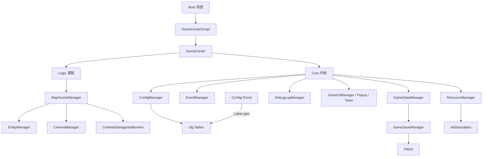

# Dragon

基于 Unity 2022.3 LTS 的 2D 游戏客户端框架，核心入口为 `GameCenter`。启动时由 `GameCenterScript` 创建系统、异步初始化各模块，并在每帧驱动状态机、调度器与地图场景。

**Unity 工程路径：** `Client/Main/`  
**核心代码路径：** `Client/Main/Assets/GameMain/`

---

## 仓库结构

```
Dragon/
├── Client/Main/          ← Unity 工程（场景、资源、GameMain 代码）
├── Config/               ← Luban 配置表源数据与生成脚本
│   ├── Datas/            ← Excel 源表（item、map、entity、skill 等）
│   ├── luban.conf        ← 生成配置（client / server / all）
│   └── gen.bat / gen.sh  ← 生成脚本
└── README.md
```

配置生成输出：
- **C# 代码** → `Client/Main/Assets/GameMain/GameConfig/`
- **JSON 数据** → `Client/Main/Assets/AddressableAssets/Configs/`

---

## GameMain 目录

代码按领域分层，统一通过 `GameCenter` 总线访问：

| 目录 | 说明 |
|------|------|
| `Center/` | `GameCenter`、`GameCenterScript` 入口 |
| `Library/` | 基础框架：资源、事件、协程、对象池、调度器、HTTP、DebugLog 等 |
| `Logic/` | 游戏逻辑：状态机、输入、音频、道具、回合制 |
| `GameBattle/` | 战斗与实体：地图场景、实体 FSM、移动/攻击控制、伤害结算、Y 轴排序渲染 |
| `GameUI/` | UI 管理：主界面、弹窗、Toast、UI 工具组件 |
| `GameData/` | 运行时用户数据与存档 |
| `GameConfig/` | Luban 自动生成，勿手改 |
| `Global/` | 全局常量、Addressables 标签名、伤害类型枚举 |

---

## 启动与生命周期

```
Boot 场景
  └─ GameCenterScript.Create()
       ├─ Awake / Start
       │    ├─ GameCenter.CreateSystem()     // 创建单例，不加载资源
       │    └─ GameCenter.Initialize()       // 协程异步初始化
       │         ├─ CoreInitialize           // 配置、资源、存档、DebugLog 等
       │         └─ LogicInitialize          // 本地化、音频、道具、地图等
       └─ 每帧 Update / LateUpdate
```

| 阶段 | 方法 | 说明 |
|------|------|------|
| 创建 | `GameCenter.CreateSystem()` | 实例化所有 Manager 单例 |
| 初始化 | `GameCenter.Initialize()` | 加载配置表、预加载资源、读存档 |
| 每帧 | `GameCenter.Update / LateUpdate` | 驱动状态机、调度器、终端、地图 |
| 卸载 | `GameCenter.Uninitialize()` | 释放音频、实体、事件、DebugLog 等 |
| 重置逻辑 | `GameCenter.ResetLogicSystem()` | 仅重建逻辑层（不重建 Core） |

访问已注册模块统一通过 `GameCenter.XXX`，例如 `GameCenter.EventManager`、`GameCenter.ConfigManager`。

---

## 模块一览

### 图例

- **GC** = 已在 `GameCenter` 中创建并持有静态引用
- **GC Init** = 在 `CoreInitialize` 或 `LogicInitialize` 中显式初始化
- **独立** = 项目内存在，需自行获取单例或调用，未纳入 `GameCenter` 生命周期

---

## 一、入口与全局

### GameCenter / GameCenterScript

| | |
|---|---|
| 命名空间 | `Dragon.Library` |
| GC | 是 |
| 概要 | 游戏总线：集中持有各 Manager、编排初始化顺序与每帧更新 |

```csharp
// 一般由 GameCenterScript 自动调用，业务侧通过静态字段访问
GameCenter.ConfigManager.Tables.Tbitem.Get(1001);
GameCenter.StateManager.ChangeState(GameStateCode.Fight, param);
```

### GlobalDefine / AddressablesLableNames

| | |
|---|---|
| 位置 | `Assets/GameMain/Global/GlobalDefine.cs` |
| 概要 | 主菜单场景名、战斗常量（重力、速度倍率）、Addressables 预加载标签名、`DamageType` 枚举 |

---

## 二、内核模块（GameCenter Core）

### ResourceManager

| | |
|---|---|
| 命名空间 | `Dragon.Resource` |
| GC / Init | 是 / `Initialize()` |
| 概要 | 基于 Addressables 的统一资源加载、引用计数、缓存与释放 |

```csharp
// 同步加载
var prefab = GameCenter.ResourceManager.Load<GameObject>("ui_lobby");

// 异步加载
GameCenter.ResourceManager.LoadAsync<Sprite>("icon_gold", sprite => { /* ... */ });

// 释放（引用计数归零后真正卸载）
GameCenter.ResourceManager.Release("icon_gold");
```

### ResourcePreloadService

| | |
|---|---|
| 命名空间 | `Dragon.Resource` |
| GC / Init | 是 / 启动时在 `CoreInitialize` 中预加载 |
| 概要 | 按 Addressables 标签批量预加载（启动时加载 Sprite / Prefab / UI 标签） |

```csharp
await GameCenter.ResourcePreloadService.PreloadByLabelAsync<GameObject>(
    "UI", onProgress: p => Debug.Log(p));
```

### ConfigManager

| | |
|---|---|
| 命名空间 | `Dragon.Config` |
| GC / Init | 是 / `Init()`（异步，Luban 配置表） |
| 概要 | 加载 JSON 配置并构建 `Tables`，供全局查表 |

```csharp
// 初始化完成后
var item = GameCenter.ConfigManager.Tables.Tbitem.Get(1001);
var map  = GameCenter.ConfigManager.Tables.Tbmap.Get(mapId);
```

### GameStateManager

| | |
|---|---|
| 命名空间 | `Dragon.Logic` |
| GC / Init | 是 / `Initialize()` |
| 概要 | 游戏顶层状态机（Init → Login → Main → Loading → Fight 等） |

```csharp
GameCenter.StateManager.ChangeState(GameStateCode.Loading, new GameLoadingParam { MapId = 1 });
bool inFight = GameCenter.StateManager.IsCurState(GameStateCode.Fight);
```

### EventManager

| | |
|---|---|
| 命名空间 | `Dragon.Library` |
| GC / Init | 是 / 懒创建（`Instance` 时挂 `EventRootScript`） |
| 概要 | 整型事件 ID 的注册/派发，支持同步与延迟触发 |

```csharp
// 注册
GameCenter.EventManager.Register(MainEventDefine.EID_ITEM_INVENTORY_CHANGED, OnItemChanged);

// 派发
GameCenter.EventManager.TriggerEvent(MainEventDefine.EID_ITEM_INVENTORY_CHANGED, param);

// 反注册
GameCenter.EventManager.UnRegister(MainEventDefine.EID_ITEM_INVENTORY_CHANGED, OnItemChanged);
```

事件 ID 定义见 `EventConstDefine`、`MainEventDefine`、`UIEventDefine`、`BattleEventDefine`。

### InputManager

| | |
|---|---|
| 命名空间 | `Dragon.GameInput` |
| GC / Init | 是 / `Init()` |
| 概要 | Unity Input System 封装，按上下文切换菜单/战斗/禁用输入 |

```csharp
GameCenter.InputManager.SetInputContext(InputManager.InputContextState.Battle);
var move = GameCenter.InputManager.BattleInput.Move.ReadValue<Vector2>();
```

### GameDataManager

| | |
|---|---|
| 命名空间 | `Dragon.GameData` |
| GC / Init | 是 / `Init()` |
| 概要 | 管理 `GameMetaData`（存档索引）与 `GameUserData`（当前角色数据） |

```csharp
var user = GameCenter.DataManager.UserData;
GameCenter.DataManager.CreateNewSaveDataInfo(uniqueId);
GameCenter.DataManager.LoadUserData(uniqueId);
```

### GameSaveManager

| | |
|---|---|
| 命名空间 | `Dragon.GameData` |
| GC / Init | 是 / `Init()` |
| 概要 | 存档读写：临时档、手动档（3 槽）、自动档（3 槽），底层使用 `FileIO` + JSON |

```csharp
GameCenter.SaveManager.SaveManualUserData(meta, uniqueId, userData, slotIndex: 0);
var loaded = GameCenter.SaveManager.LoadManualUserData(meta, uniqueId, slotIndex: 0);
```

### GameUIManager

| | |
|---|---|
| 命名空间 | `Dragon.GameUI` |
| GC / Init | 是 / 懒创建 |
| 概要 | 主界面与单层 UI 的加载、缓存、显示/隐藏（预制体需挂 `UIBase`） |

```csharp
await GameCenter.GameUIManager.OpenMainUI<UILobby, UILobbyData>("ui_lobby", data);
await GameCenter.GameUIManager.OpenSingleUI<UIFight, UIFightData>("ui_fight", sortingOrder: 10, data);
GameCenter.GameUIManager.CloseUI("ui_fight");
```

### PopupManager

| | |
|---|---|
| 命名空间 | `Dragon.GameUI` |
| GC / Init | 是 / 懒创建 |
| 概要 | 弹窗栈管理，支持缓存复用、置顶 |

```csharp
GameCenter.PopupManager.OpenPopup("popup_confirm", new PopupConfirmData { /* ... */ });
GameCenter.PopupManager.ClosePopup("popup_confirm");
```

### ToastManager

| | |
|---|---|
| 命名空间 | `Dragon.GameUI` |
| GC / Init | 是 / 懒创建 |
| 概要 | 浮动提示，每次 `Show` 实例化一条，支持多条并存；渐隐动画基于 DOTween |

```csharp
GameCenter.ToastManager.Show("获得金币 x100");
GameCenter.ToastManager.Show("保存成功", displayDuration: 2f);
```

### UIQueueManager

| | |
|---|---|
| 命名空间 | `Dragon.GameUI` |
| GC / Init | 是 / 懒创建 |
| 概要 | UI/弹窗顺序队列：上一项关闭后再打开下一项 |

```csharp
GameCenter.UIQueueManager.EnqueuePopup("popup_story", storyData);
GameCenter.UIQueueManager.EnqueueOpenMainUI<UILobby, UILobbyData>("ui_lobby", lobbyData);
GameCenter.UIQueueManager.ClearPending(); // 清空未执行的队列
```

### PoolManager

| | |
|---|---|
| 命名空间 | `Dragon.Library` |
| GC / Init | 是 / 懒创建（卸载时 `ClearAll`） |
| 概要 | GameObject 预制体对象池，支持同步注册与 Addressables 异步注册 |

```csharp
GameCenter.PoolManager.Register("fx_hit", hitPrefab, prewarm: 5, maxInactive: 20);
var go = GameCenter.PoolManager.Get("fx_hit");
GameCenter.PoolManager.Release("fx_hit", go);

// 异步注册
await GameCenter.PoolManager.RegisterAsync("fx_hit", prewarm: 5);
```

实现 `IPoolReset` 可在取出/归还时重置状态。

### SchedulerManager

| | |
|---|---|
| 命名空间 | `Dragon.Library` |
| GC / Init | 是 / `Init()`，每帧 `Update` |
| 概要 | 轻量任务调度：延迟、间隔、下一帧、每帧回调，支持按 owner 批量取消 |

```csharp
int id = GameCenter.SchedulerManager.Delay(1.5f, () => Debug.Log("延迟执行"), owner: this);
GameCenter.SchedulerManager.Interval(0.5f, OnTick, owner: this);
GameCenter.SchedulerManager.CancelByOwner(this);
```

### DebugLogManager

| | |
|---|---|
| 命名空间 | `Dragon.Library` |
| 位置 | `Assets/GameMain/Library/DebugLog/` |
| GC / Init | 是 / `Init()`（`NewCoreSystem` 中调用），卸载时 `Shutdown()` |
| 概要 | 收集 Unity Console 日志到内存缓冲，配合 `popup_debug_log` 弹窗查看 |

```csharp
// 启动后自动收集，也可手动打开弹窗
GameCenter.DebugLogManager.OpenPopup();
string all = GameCenter.DebugLogManager.GetFullText();
GameCenter.DebugLogManager.Clear();
```

---

## 三、逻辑模块（GameCenter Logic）

### LocalManager

| | |
|---|---|
| 命名空间 | `Dragon.Localization` |
| GC / Init | 是 / `Init()` |
| 概要 | 多语言切换，从 Luban `Tblocalization` 按 ID 取文案 |

```csharp
GameCenter.LocalManager.SwitchLanguage(LanguageType.English);
string text = GameCenter.LocalManager.GetLocalString("10001"); // key 为配置表 ID

// UI 组件：LocalString + LocalStringUIHandler 自动刷新
```

### TerminalManager

| | |
|---|---|
| 命名空间 | `Dragon.Library` |
| GC / Init | 是 / `Init()`，每帧 `Update` |
| 概要 | 游戏内调试终端（GM 命令行），可注册自定义命令 |

```csharp
GameCenter.TerminalManager.RegisterCommand("give", 2, "给予道具 {0} x{1}");
// 默认快捷键打开终端弹窗，在 Update 中检测输入
```

### AudioManager

| | |
|---|---|
| 命名空间 | `Dragon.Audio` |
| GC / Init | 是 / `Init()` |
| 概要 | BGM / 环境音双通道交叉淡化，音效多通道池，资源为 Addressables 地址 |

```csharp
GameCenter.AudioManager.PlayBgm("bgm_main", loop: true);
GameCenter.AudioManager.PlayAmbient("amb_forest");
GameCenter.AudioManager.PlaySfx("sfx_click");
GameCenter.AudioManager.BgmVolume = 0.8f;
```

### ItemManager

| | |
|---|---|
| 命名空间 | `Dragon.Logic` |
| GC / Init | 是 / `Init()` |
| 概要 | 道具表校验、背包读写、数量变更后派发 `EID_ITEM_INVENTORY_CHANGED` |

```csharp
GameCenter.ItemManager.TryGain(itemId: 1001, count: 5);
GameCenter.ItemManager.TryConsume(itemId: 1001, count: 2);
int n = GameCenter.ItemManager.GetItemCount(1001);
```

### MapSceneManager

| | |
|---|---|
| 命名空间 | `Dragon.Logic` |
| GC / Init | 是 / `Init()`，每帧 `Update` / `LateUpdate` |
| 概要 | 地图场景加载、实体生成、相机跟随；持有 `EntityManager`、`CameraManager`、`EntitySpawnner` |

```csharp
GameCenter.MapSceneManager.LoadSceneAndSpawnAsync(mapId: 1);
// 场景加载完成后自动 InitEntitySpawnner → SpawnAllEntities
var player = GameCenter.MapSceneManager.EntityManager.Entities; // 遍历实体
```

---

## 四、战斗子模块（随 MapSceneManager 创建，未单独挂 GameCenter）

### EntityManager

| | |
|---|---|
| 命名空间 | 全局（无 namespace） |
| 概要 | 战斗实体列表、Skin 同步、占位检测、生命周期 `Update` / `LateUpdate` |

通过 `GameCenter.MapSceneManager.EntityManager` 访问。

实体分层结构：

| 子目录 | 说明 |
|--------|------|
| `EntityData/` | 纯数据：Character（Player/Enemy/Npc）、Interactable（Block） |
| `EntityInherit/` | 运行时实体类：Character、Player、Enemy、Npc、Block |
| `EntityState/` | 实体 FSM 状态（Idle/Move/Run/Jump/Birth/Death 等） |
| `EntityControl/` | 输入提供者、移动控制器、攻击控制器 |
| `EntityCombat/` | 伤害结算（`CombatDamageSettlement`、`IAttackable`） |
| `EntityAction/` | 预留目录，尚无实现 |

### CameraManager

| | |
|---|---|
| 命名空间 | `Dragon.Logic` |
| 概要 | Cinemachine 虚拟相机，绑定玩家并在 X 轴阈值内跟随 |

通过 `GameCenter.MapSceneManager.CameraManager` 访问。

### EntitySpawnner

| | |
|---|---|
| 命名空间 | 全局 |
| 概要 | 读取场景 `SpawnRoot` 下 `SpawnPoint`，按配置生成 NPC / 敌人 / 玩家 |

地图场景需包含名为 `SpawnRoot` 的 GameObject。

### CombatDamageSettlement

| | |
|---|---|
| 命名空间 | 全局 |
| 概要 | 统一伤害结算入口，基于双方 `Entity.Data` 属性计算最终伤害 |

```csharp
var result = CombatDamageSettlement.Settle(attacker, defender, hitContext);
float damage = result.FinalDamage;
```

相关类型：`AttackHitContext`（命中上下文）、`DamageSettlementResult`（结算结果）、`IAttackable`（可受击接口）。

### YSortRenderer

| | |
|---|---|
| 命名空间 | 全局 |
| 位置 | `Assets/GameMain/GameBattle/Render/` |
| 概要 | 根据世界坐标 Y 轴动态调整 `Renderer.sortingOrder`，实现 2D 前后遮挡 |

挂在角色或场景物件上；渲染器在子节点时，指定 `_sortTransform` 为逻辑位置节点。

### RoundManager

| | |
|---|---|
| 命名空间 | `Dragon.Logic` |
| GC | **否**（`GameCenter` 中已注释，需手动使用） |
| 概要 | 回合制整场调度：Prepare → Execute（依次 Turn）→ End，支持参与者增删与超时 |

```csharp
var round = RoundManager.Instance;
round.Init();
round.TryAddParticipant(participant);
round.StartRound(RoundType.Battle);
round.NotifyRoundEndCompleted(participant);
```

---

## 五、基础库（Library，多数未纳入 GameCenter）

### CoroutinePool

| | |
|---|---|
| 命名空间 | `Dragon.Library` |
| 概要 | 全局协程宿主，`GameCenter.Initialize` 内部用于启动初始化协程 |

```csharp
CoroutinePool.AddTask(MyCoroutine());
CoroutinePool.StopTask(routine);
```

### TimeUtils

| | |
|---|---|
| 命名空间 | `Dragon.Library` |
| 概要 | 受游戏速度影响的 `DeltaTime`；`GameCenterScript` 每帧调用 `Update` |

```csharp
GameCenter.SetGameSpeedRate(2f);  // 2 倍速
float dt = TimeUtils.DeltaTime;   // 已乘速度系数
```

### CountdownHelper / StopwatchHelper / TimeFormatUtils

| | |
|---|---|
| 命名空间 | `Dragon.Library` |
| 概要 | 倒计时（基于 Scheduler）、秒表、时间格式化工具 |

```csharp
CountdownHelper.StartCountdown(60f, onTick: sec => UpdateLabel(sec), onCompleted: OnTimeUp, owner: this);
CountdownHelper.CancelByOwner(this);
```

### FiniteStateMachine（FSM）

| | |
|---|---|
| 命名空间 | `Dragon.Library` |
| 概要 | 通用有限状态机；`GameStateManager` 与实体状态（如 `CharacterIdleState`）均基于此 |

```csharp
var fsm = new FiniteStateMachine("MyFsm", host);
fsm.Register(new MyState());
fsm.TransToState(stateId, arg);
fsm.Update(dt);
```

### FileIO

| | |
|---|---|
| 命名空间 | 全局 |
| 概要 | 用户数据读写；Editor 下路径为 `Assets/AddressableAssets/UserData`，真机为 `persistentDataPath` |

```csharp
FileIO.WriteData(subFolder, "save.json", json);
string json = FileIO.ReadData(subFolder, "save.json");
bool exists = FileIO.DataExists(subFolder, "save.json");
```

### PathUtils

| | |
|---|---|
| 命名空间 | `Dragon.Library` |
| 概要 | 跨平台资源路径 Provider（Editor / Android / iOS / WebGL / Win），支持研发路径切换 |

```csharp
string path = PathUtils.GetFullPath(relativePath);
PathUtils.IsDevEnv = true; // 仅 Editor 有效
```

### HttpHelper

| | |
|---|---|
| 命名空间 | `Dragon.Library` |
| 概要 | `UnityWebRequest` + UniTask 的 GET/POST 封装，支持超时与取消 |

```csharp
var resp = await HttpHelper.GetAsync("https://api.example.com/data");
if (resp.IsSuccess) Debug.Log(resp.Text);
```

### IDUtils

| | |
|---|---|
| 命名空间 | `Dragon.Library` |
| 概要 | 线程安全的唯一 long ID 生成（时间戳 + 计数器） |

```csharp
long saveId = IDUtils.NewId();
```

### ResourceManagerDebugger

| | |
|---|---|
| 命名空间 | `Dragon.Resource` |
| 概要 | 资源管理器调试辅助（统计缓存、引用计数等），开发期使用 |

---

## 六、配置与数据（GameConfig / GameData）

| 模块 | 说明 |
|------|------|
| `cfg.Tables` / `GameConfig/` | Luban 生成的配置表代码 |
| `dragon/` | item、map、localization |
| `entity/dragon/` | player、enemy、npc、block、CharacterAttr |
| `skill/dragon/` | actionSkill、launchSkill、buffSkill、buff |
| `GameUserData` / `GameMetaData` | 运行时用户数据与存档元信息 |
| `ConfigFileList` | 配置清单 ScriptableObject，驱动 `ConfigManager` 批量加载 |

查表统一入口：`GameCenter.ConfigManager.Tables`（须等待 `ConfigManager.Init()` 完成）。

配置表修改流程：编辑 `Config/Datas/` 下 Excel → 运行 `Config/gen.bat` → 重新导入 Unity。

---

## 七、UI 基类与工具组件

### 基类约定

| 类型 | 基类 | 管理器 |
|------|------|--------|
| 主界面 / 单层 UI | `UIBase<TData>` | `GameUIManager` |
| 弹窗 | `PopupBase<TData>` | `PopupManager` / `UIQueueManager` |
| Toast | `UIToast` | `ToastManager` |
| 本地化文本 | `LocalString` | 挂到 Text，随 `LocalManager.LanguageChanged` 刷新 |
| Debug 日志弹窗 | `PopupDebugLog` | 通过 `DebugLogManager.OpenPopup()` 打开 |

预制体通过 Addressables 地址加载，地址字符串通常与资源名一致（如 `"ui_lobby"`、`"popup_confirm"`）。

### UI 工具组件

挂载在 UI 预制体节点上，无需纳入 `GameCenter`：

| 组件 | 说明 |
|------|------|
| `UIDisplayEffect` | Enable 时播放显示动效（如 ScaleIn），基于 DOTween |
| `UIObjectStateMachine` | 两组对象列表在 Collapsed / Expanded 状态间切换 |
| `UISpriteAnimator` | Image 帧动画播放，支持循环与 OnEnable 自动播放 |
| `UITMPOutlineEffect` | TMP 描边/面/底纹效果，编辑器即时预览 |

---

## 八、推荐依赖关系（简图）



---

## 九、扩展新模块的建议

1. 实现单例或 `Instance` 访问器，必要时实现 `Init` / `Shutdown` / `Clear`。
2. 若需全局访问且参与启动流程，在 `GameCenter` 增加静态字段，并在 `NewCoreSystem` / `NewLogicSystem` 与对应 `Initialize` / `Uninitialize` 中注册。
3. 若需每帧更新，在 `GameCenter.Update` 或 `LateUpdate` 中调用。
4. 跨模块通信优先使用 `EventManager` + `EventConstDefine` 分段 ID，避免硬引用。
5. 资源加载统一走 `ResourceManager`，配置读取走 `ConfigManager.Tables`。

---

## 技术栈

| 类别 | 技术 | 版本 |
|------|------|------|
| 引擎 | Unity | 2022.3.62f3c1 LTS |
| 渲染 | URP (2D) | 14.0.12 |
| 资源 | Addressables | 1.22.3 |
| 异步 | UniTask | Plugins 内置 |
| 配置 | Luban | 1.1.1 |
| 输入 | Unity Input System | 1.14.2 |
| 相机 | Cinemachine | 2.10.7 |
| 动画/UI 动效 | DOTween | Demigiant 插件 |
| 文本 | TextMesh Pro + MiSans 字体 | 3.0.9 |
| 序列化 | Newtonsoft.Json | 3.2.2 |
| IDE | Cursor IDE 包 | 2.0.27 |
