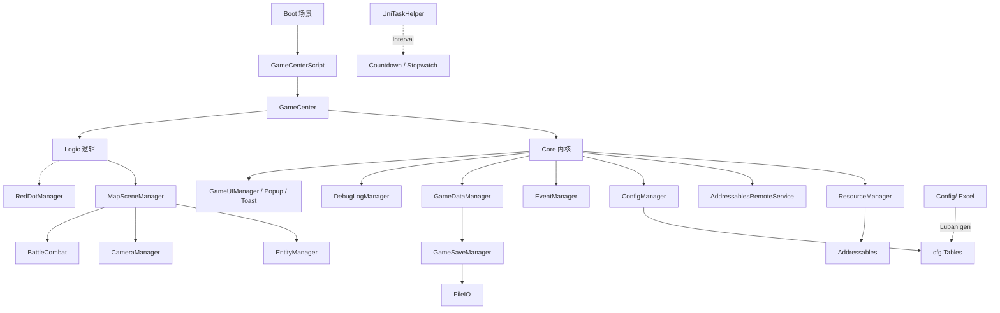

# Dragon

基于 Unity 2022.3 LTS 的 2D 游戏客户端框架，核心入口为 `GameCenter`。启动时由 `GameCenterScript` 创建系统、以 **UniTask** 异步初始化各模块，并在每帧驱动状态机、终端与地图场景。定时调度统一使用 `UniTaskHelper`（已替代旧版 `SchedulerManager` / `CoroutinePool`）。

**Unity 工程路径：** `Client/Main/`  
**核心代码路径：** `Client/Main/Assets/GameMain/`

---

## 仓库结构

```
Dragon/
├── Client/Main/          ← Unity 工程（场景、资源、GameMain 代码）
├── Config/               ← Luban 配置表源数据与生成脚本
│   ├── Datas/            ← Excel 源表（item、map、localization、entity、combat 等）
│   ├── luban.conf        ← 生成配置（client / server / all）
│   └── gen.bat / gen.sh  ← 生成脚本
└── README.md
```

配置生成输出：
- **C# 代码** → `Client/Main/Assets/GameMain/GameConfig/`
- **JSON 数据** → `Client/Main/Assets/AddressableAssets/Configs/`

---

## GameMain 目录

代码按领域分层，统一通过 `GameCenter` 总线访问：

| 目录 | 说明 |
|------|------|
| `Center/` | `GameCenter`、`GameCenterScript` 入口 |
| `Library/` | 基础框架：资源、事件、对象池、Time（`UniTaskHelper`）、UI 工具、Transform、HTTP、DebugLog、配置 Editor 工具等 |
| `Logic/` | 游戏逻辑：状态机、输入、音频、道具、**红点系统** |
| `Logic/RedDot/` | 红点树、Provider 模板、Registry 注册入口、UI 绑定组件 |
| `GameBattle/` | 地图场景、实体，以及 `Combat/` 下的发射器、子弹、Buff、修改器和结算 |
| `GameUI/` | UI 管理：主界面、弹窗、Toast、道具界面 |
| `GameData/` | 运行时用户数据与存档 |
| `GameConfig/` | Luban 自动生成，勿手改 |
| `Global/` | 全局常量、战斗数值、伤害类型枚举 |

---

## 启动与生命周期

```
Boot 场景
  └─ GameCenterScript.Create()
       ├─ Awake / Start
       │    ├─ GameCenter.CreateSystem()     // 创建单例，不加载资源
       │    └─ GameCenter.Initialize()       // UniTask 异步初始化（Forget）
       │         ├─ CoreInitializeAsync      // Addressables 准备、配置、资源预加载、存档等
       │         └─ LogicInitialize          // 本地化、音频、道具、地图等
       └─ 每帧 Update / LateUpdate / FixedUpdate
```

| 阶段 | 方法 | 说明 |
|------|------|------|
| 创建 | `GameCenter.CreateSystem()` | 实例化所有 Manager 单例 |
| 初始化 | `GameCenter.Initialize()` | Addressables 初始化/Catalog/下载 → 加载配置表 → 预加载启动标签 → 读存档；完成后切到 `GameStateCode.Main` |
| 每帧 | `GameCenter.Update / LateUpdate` | 驱动状态机、终端、地图 |
| 卸载 | `GameCenter.Uninitialize()` | 释放音频、实体、事件、DebugLog 等 |
| 重置逻辑 | `GameCenter.ResetLogicSystem()` | 仅重建逻辑层（不重建 Core） |

访问已注册模块统一通过 `GameCenter.XXX`，例如 `GameCenter.EventManager`、`GameCenter.ConfigManager`。

---

## 模块一览

### 图例

- **GC** = 已在 `GameCenter` 中创建并持有静态引用
- **GC Init** = 在 `CoreInitializeAsync` 或 `LogicInitialize` 中显式初始化
- **独立** = 项目内存在，需自行获取单例或调用，未纳入 `GameCenter` 生命周期

---

## 一、入口与全局

### GameCenter / GameCenterScript

| | |
|---|---|
| 命名空间 | `Dragon.Library` |
| GC | 是 |
| 概要 | 游戏总线：集中持有各 Manager、编排初始化顺序与每帧更新 |

```csharp
// 一般由 GameCenterScript 自动调用，业务侧通过静态字段访问
GameCenter.ConfigManager.Tables.Tbitem.Get(1001);
GameCenter.StateManager.ChangeState(GameStateCode.Fight, param);
```

### GlobalDefine

| | |
|---|---|
| 位置 | `Assets/GameMain/Global/GlobalDefine.cs` |
| 概要 | 主菜单场景名、战斗常量（重力、速度倍率）、音量默认值。伤害类型在 Luban 枚举 `cfg.combat.dragon.DamageType` |

### AddressablesLabelNames

| | |
|---|---|
| 命名空间 | `Dragon.Resource` |
| 位置 | `Assets/GameMain/Library/Resource/AddressablesLabelNames.cs` |
| 概要 | Addressables 标签常量（Sprite / Prefab / UI / Audio）及 `BootstrapEntries` 启动预加载配置 |

```csharp
// 追加启动预加载标签时，在此扩展 BootstrapEntries
AddressablesLabelNames.BootstrapEntries
```

---

## 二、内核模块（GameCenter Core）

### ResourceManager

| | |
|---|---|
| 命名空间 | `Dragon.Resource` |
| GC / Init | 是 / `Initialize()` |
| 概要 | 基于 Addressables 的统一资源加载、引用计数、缓存与释放 |

```csharp
// 同步加载
var prefab = GameCenter.ResourceManager.Load<GameObject>("ui_lobby");

// 异步加载
GameCenter.ResourceManager.LoadAsync<Sprite>("icon_gold", sprite => { /* ... */ });

// 释放（引用计数归零后真正卸载）
GameCenter.ResourceManager.Release("icon_gold");
```

### AddressablesRemoteService

| | |
|---|---|
| 命名空间 | `Dragon.Resource` |
| GC / Init | 是 / `CoreInitializeAsync` 中 `PrepareStartupResourcesAsync` |
| 概要 | Addressables 远程资源生命周期：运行时初始化、Catalog 更新、按 key/标签下载依赖；未配置 Remote 时自动跳过 |

```csharp
// 启动流程（GameCenter 已调用）
await GameCenter.AddressablesRemoteService.PrepareStartupResourcesAsync(
    ResourcePreloadService.GetStartupDownloadKeys(), onProgress: p => { /* ... */ });

// 单独使用
await GameCenter.AddressablesRemoteService.InitializeAsync();
bool updated = await GameCenter.AddressablesRemoteService.UpdateCatalogsAsync();
long size = await GameCenter.AddressablesRemoteService.GetDownloadSizeAsync("UI");
```

### ResourcePreloadService

| | |
|---|---|
| 命名空间 | `Dragon.Resource` |
| GC / Init | 是 / 启动时在 `CoreInitializeAsync` 中预加载 |
| 概要 | 按 Addressables 标签批量预加载；`GetStartupDownloadKeys()` 汇总 Config 标签 + `BootstrapEntries` 供下载 |

```csharp
// 启动预加载（读取 AddressablesLabelNames.BootstrapEntries）
await GameCenter.ResourcePreloadService.PreloadBootstrapResourcesAsync(onProgress: p => Debug.Log(p));

// 按标签预加载
await GameCenter.ResourcePreloadService.PreloadByLabelAsync<GameObject>(
    AddressablesLabelNames.UI, onProgress: p => Debug.Log(p));
```

### ConfigManager

| | |
|---|---|
| 命名空间 | `Dragon.Config` |
| GC / Init | 是 / `Init()`（异步，Luban 配置表） |
| 概要 | 加载 JSON 配置并构建 `Tables`，供全局查表 |

```csharp
// 初始化完成后
var item = GameCenter.ConfigManager.Tables.Tbitem.Get(1001);
var map  = GameCenter.ConfigManager.Tables.Tbmap.Get(mapId);
```

### GameStateManager

| | |
|---|---|
| 命名空间 | `Dragon.Logic` |
| GC / Init | 是 / `Initialize()` |
| 概要 | 游戏顶层状态机（Init → Update → PreLoad → Login → Main → Loading → Fight） |

```csharp
GameCenter.StateManager.ChangeState(GameStateCode.Loading, new GameLoadingParam { MapId = 1 });
bool inFight = GameCenter.StateManager.IsCurState(GameStateCode.Fight);
```

状态实现目录：`Logic/GameState/State/`（`10_Init` … `60_Fight`）。

### EventManager

| | |
|---|---|
| 命名空间 | `Dragon.Library` |
| GC / Init | 是 / 懒创建（`Instance` 时挂 `EventRootScript`） |
| 概要 | 整型事件 ID 的注册/派发，支持同步与延迟触发 |

```csharp
// 注册
GameCenter.EventManager.Register(MainEventDefine.EID_ITEM_INVENTORY_CHANGED, OnItemChanged);

// 派发
GameCenter.EventManager.TriggerEvent(MainEventDefine.EID_ITEM_INVENTORY_CHANGED, param);

// 反注册
GameCenter.EventManager.UnRegister(MainEventDefine.EID_ITEM_INVENTORY_CHANGED, OnItemChanged);
```

事件 ID 定义见 `EventConstDefine`、`MainEventDefine`、`UIEventDefine`、`BattleEventDefine`。

### InputManager

| | |
|---|---|
| 命名空间 | `Dragon.GameInput` |
| GC / Init | 是 / `Init()` |
| 概要 | Unity Input System 封装，按上下文切换菜单/战斗/禁用输入 |

```csharp
GameCenter.InputManager.SetInputContext(InputManager.InputContextState.Battle);
var move = GameCenter.InputManager.BattleInput.Move.ReadValue<Vector2>();
```

### GameDataManager

| | |
|---|---|
| 命名空间 | `Dragon.GameData` |
| GC / Init | 是 / `Init()` |
| 概要 | 管理 `GameMetaData`（存档索引）与 `GameUserData`（当前角色数据） |

```csharp
var user = GameCenter.DataManager.UserData;
GameCenter.DataManager.CreateNewSaveDataInfo(uniqueId);
GameCenter.DataManager.LoadUserData(uniqueId);
```

### GameSaveManager

| | |
|---|---|
| 命名空间 | `Dragon.GameData` |
| GC / Init | 是 / `Init()` |
| 概要 | 存档读写：临时档、手动档（3 槽）、自动档（3 槽），底层使用 `FileIO` + JSON |

```csharp
GameCenter.SaveManager.SaveManualUserData(meta, uniqueId, userData, slotIndex: 0);
var loaded = GameCenter.SaveManager.LoadManualUserData(meta, uniqueId, slotIndex: 0);
```

### GameUIManager

| | |
|---|---|
| 命名空间 | `Dragon.GameUI` |
| GC / Init | 是 / 懒创建 |
| 概要 | 主界面与单层 UI 的加载、缓存、显示/隐藏（预制体需挂 `UIBase`） |

```csharp
await GameCenter.GameUIManager.OpenMainUI<UILobby, UILobbyData>("ui_lobby", data);
await GameCenter.GameUIManager.OpenSingleUI<UIFight, UIFightData>("ui_fight", sortingOrder: 10, data);
GameCenter.GameUIManager.CloseUI("ui_fight");
```

### PopupManager

| | |
|---|---|
| 命名空间 | `Dragon.GameUI` |
| GC / Init | 是 / 懒创建 |
| 概要 | 弹窗栈管理，支持缓存复用、置顶；关闭时若挂有 `UIDisplayEffect` 退场动效，会等动效播完再销毁/回收 |

```csharp
GameCenter.PopupManager.OpenPopup("popup_confirm", new PopupConfirmData { /* ... */ });
GameCenter.PopupManager.ClosePopup("popup_confirm");
```

### ToastManager

| | |
|---|---|
| 命名空间 | `Dragon.GameUI` |
| GC / Init | 是 / 懒创建 |
| 概要 | 浮动提示，每次 `Show` 实例化一条，支持多条并存；渐隐动画基于 DOTween |

```csharp
GameCenter.ToastManager.Show("获得金币 x100");
GameCenter.ToastManager.Show("保存成功", displayDuration: 2f);
```

### UIQueueManager

| | |
|---|---|
| 命名空间 | `Dragon.GameUI` |
| GC / Init | 是 / 懒创建 |
| 概要 | UI/弹窗顺序队列：上一项关闭后再打开下一项 |

```csharp
GameCenter.UIQueueManager.EnqueuePopup("popup_story", storyData);
GameCenter.UIQueueManager.EnqueueOpenMainUI<UILobby, UILobbyData>("ui_lobby", lobbyData);
GameCenter.UIQueueManager.ClearPending(); // 清空未执行的队列
```

### PoolManager

| | |
|---|---|
| 命名空间 | `Dragon.Library` |
| GC / Init | 是 / 懒创建（卸载时 `ClearAll`） |
| 概要 | GameObject 预制体对象池，支持同步注册与 Addressables 异步注册 |

```csharp
GameCenter.PoolManager.Register("fx_hit", hitPrefab, prewarm: 5, maxInactive: 20);
var go = GameCenter.PoolManager.Get("fx_hit");
GameCenter.PoolManager.Release("fx_hit", go);

// 异步注册
await GameCenter.PoolManager.RegisterAsync("fx_hit", prewarm: 5);
```

实现 `IPoolReset` 可在取出/归还时重置状态。

### DebugLogManager

| | |
|---|---|
| 命名空间 | `Dragon.Library` |
| 位置 | `Assets/GameMain/Library/DebugLog/` |
| GC / Init | 是 / `Init()`（`NewCoreSystem` 中调用），卸载时 `Shutdown()` |
| 概要 | 收集 Unity Console 日志到内存缓冲，配合 `popup_debug_log` 弹窗查看 |

```csharp
// 启动后自动收集，也可手动打开弹窗
GameCenter.DebugLogManager.OpenPopup();
string all = GameCenter.DebugLogManager.GetFullText();
GameCenter.DebugLogManager.Clear();
```

---

## 三、逻辑模块（GameCenter Logic）

### LocalManager

| | |
|---|---|
| 命名空间 | `Dragon.Localization` |
| GC / Init | 是 / `Init()` |
| 概要 | 多语言切换，从 Luban `Tblocalization` 按 ID 取文案 |

```csharp
GameCenter.LocalManager.SwitchLanguage(LanguageType.English);
string text = GameCenter.LocalManager.GetLocalString("10001"); // key 为配置表 ID

// UI 组件：LocalizationUIHandler 自动刷新（挂到 TMP 或代码绑定）
LocalizationHelper.SetText(tmpText, "10001");

// 编辑器：LocalStringEditorPreview 可在非 Play 模式预览文案
```

### TerminalManager

| | |
|---|---|
| 命名空间 | `Dragon.Library` |
| GC / Init | 是 / `Init()`，每帧 `Update` |
| 概要 | 游戏内调试终端（GM 命令行），可注册自定义命令 |

```csharp
GameCenter.TerminalManager.RegisterCommand("give", 2, "给予道具 {0} x{1}");
// 默认快捷键打开终端弹窗，在 Update 中检测输入
```

### AudioManager

| | |
|---|---|
| 命名空间 | `Dragon.Audio` |
| GC / Init | 是 / `Init()` |
| 概要 | BGM / 环境音双通道交叉淡化，音效多通道池，资源为 Addressables 地址 |

```csharp
GameCenter.AudioManager.PlayBgm("bgm_main", loop: true);
GameCenter.AudioManager.PlayAmbient("amb_forest");
GameCenter.AudioManager.PlaySfx("sfx_click");
GameCenter.AudioManager.BgmVolume = 0.8f;
```

### ItemManager

| | |
|---|---|
| 命名空间 | `Dragon.Logic` |
| GC / Init | 是 / `Init()` |
| 概要 | 道具表校验、背包读写、数量变更后派发 `EID_ITEM_INVENTORY_CHANGED` |

```csharp
GameCenter.ItemManager.TryGain(itemId: 1001, count: 5);
GameCenter.ItemManager.TryConsume(itemId: 1001, count: 2);
int n = GameCenter.ItemManager.GetItemCount(1001);
```

### MapSceneManager

| | |
|---|---|
| 命名空间 | `Dragon.Logic` |
| GC / Init | 是 / `Init()`，每帧 `Update` / `LateUpdate` |
| 概要 | 地图场景加载、实体生成、相机跟随；持有 `EntityManager`、`CameraManager`、`EntitySpawnner` |

```csharp
GameCenter.MapSceneManager.LoadSceneAndSpawnAsync(mapId: 1);
// 场景加载完成后自动 InitEntitySpawnner → SpawnAllEntities
var player = GameCenter.MapSceneManager.EntityManager.Entities; // 遍历实体
```

### RedDotManager（红点系统）

| | |
|---|---|
| 命名空间 | `Dragon.Logic` |
| 位置 | `Assets/GameMain/Logic/RedDot/` |
| GC / Init | **否**（独立单例；接入时在 `LogicInitialize` 调用 `Init()`） |
| 概要 | 树形红点中枢：叶子 Provider 计算数值 → 非叶子聚合 → 派发 `EID_REDDOT_CHANGED`；UI 只负责展示 |

**目录结构：**

| 子目录/文件 | 说明 |
|-------------|------|
| `RedDotManager.cs` | 树注册、脏标记、向上聚合、事件派发 |
| `RedDotRegistry.cs` | **集中注册入口**：非叶子 `RegisterNode`、叶子 `RegisterLeaf` |
| `RedDotKey.cs` | key 常量（`.` 分段表示层级，如 `lobby.mail.system`） |
| `Providers/RedDotExampleProvider.cs` | **Provider 模板**，复制后实现 `Evaluate()` |
| `RedDotUI/RedDotView.cs` | UI 挂载：监听变化、显隐与计数展示 |
| `RedDotUI/RedDotEnterClear.cs` | 入口点击消红点（`SeenUntilEnter` / `OncePerSession`） |

**接入步骤：**

```csharp
// 1. RedDotKey.cs 增加 key 常量
public const string LobbyShop = "lobby.shop";

// 2. 复制 RedDotExampleProvider → Providers/RedDotShopProvider.cs，实现 Evaluate
public RedDotValue Evaluate()
{
    int count = GameCenter.ItemManager.GetNewShopItemCount();
    return count > 0 ? new RedDotValue(count) : RedDotValue.None;
}

// 3. RedDotRegistry.RegisterAll 中注册树
manager.RegisterLeaf(RedDotKey.LobbyShop, RedDotKey.Lobby,
    new RedDotShopProvider(RedDotKey.LobbyShop, RedDotRefreshMode.Dynamic,
        MainEventDefine.EID_ITEM_INVENTORY_CHANGED));

// 4. GameCenter.LogicInitialize 中初始化（接入后）
RedDotManager.Instance.Init();

// 5. UI 预制体挂 RedDotView，Inspector 填 key；按钮挂 RedDotEnterClear.OnClickClear
```

**核心 API：**

```csharp
RedDotManager.Instance.GetValue("lobby.mail");       // 查询聚合值
RedDotManager.Instance.IsVisible("lobby");             // 是否显示
RedDotManager.Instance.MarkDirty("lobby.mail.system"); // 业务数据变化后标记脏
RedDotManager.Instance.MarkSeen("seen.tutorial");      // 点进即消
RedDotManager.Instance.RefreshAll();                   // 登录/全量拉取后重算
```

**枚举说明：**

| 类型 | 值 | 说明 |
|------|-----|------|
| `RedDotRefreshMode` | `Dynamic` | 数据变化即重算 |
| | `SeenUntilEnter` | 进入界面或 `MarkSeen` 后消隐，PlayerPrefs 持久化 |
| | `OncePerSession` | 本次进程内消隐，不持久化 |
| `RedDotAggregateMode` | `Or` / `Sum` / `Max` | 非叶子对子节点的聚合方式 |
| `RedDotDisplayStyle` | `DotOnly` / `CountOnly` / `DotAndCount` / `DotOrCount` | `RedDotView` 展示样式 |

---

## 四、战斗子模块（随 MapSceneManager 创建，未单独挂 GameCenter）

### EntityManager

| | |
|---|---|
| 命名空间 | 全局（无 namespace） |
| 概要 | 战斗实体列表、Skin 同步、占位检测、生命周期 `Update` / `LateUpdate` |

通过 `GameCenter.MapSceneManager.EntityManager` 访问。

实体分层结构：

| 子目录 | 说明 |
|--------|------|
| `EntityData/` | 纯数据：Character（Player/Enemy/Npc）、Interactable（Block） |
| `EntityInherit/` | 运行时实体类：Character、Player、Enemy、Npc、Block |
| `EntityState/` | 实体 FSM 状态（Idle/Move/Run/Jump/Birth/Death 等） |
| `EntityControl/` | 输入提供者、移动控制器、攻击控制器 |
| `Entity.Battle.cs` | 阵营、Buff、发射器、移动/攻击/无敌锁、伤害抗性 |
| `Combat/` | 发射器、子弹、Buff、修改器、战斗物件、结算 |

### CameraManager

| | |
|---|---|
| 命名空间 | `Dragon.Logic` |
| 概要 | Cinemachine 虚拟相机，绑定玩家并在 X 轴受限内跟随 |

通过 `GameCenter.MapSceneManager.CameraManager` 访问。

### EntitySpawnner

| | |
|---|---|
| 命名空间 | 全局 |
| 概要 | 读取场景 `SpawnRoot` 下 `SpawnPoint`，按配置生成 NPC / 敌人 / 玩家 |

地图场景需包含名为 `SpawnRoot` 的 GameObject。

### 战斗系统

代码在 `Assets/GameMain/GameBattle/Combat/`。一场战斗由 `MapSceneManager.BattleCombat` 持有：子弹管理器，以及每个阵营的局内修改器。实体在 `BindBattleCombat` 时挂上 Buff、修改板和初始发射器。

每帧先 `EntityManager.Update`（Buff、移动、攻击输入、发射器），再 `BattleCombat.Update`（子弹）。区域子弹读到的是这一帧已经更新过的发射器朝向。

战斗代码直接读 Luban 表，没有第二份运行时配置。`ConfigManager.Init()` 完成之后：

```csharp
ConfigManager.Instance.Tables.Tbemitter.GetOrDefault(id);
ConfigManager.Instance.Tables.Tbbullet.GetOrDefault(id);
ConfigManager.Instance.Tables.Tbbuff.GetOrDefault(id);
ConfigManager.Instance.Tables.Tbmodifier.GetOrDefault(id);
ConfigManager.Instance.Tables.TbcombatProp.GetOrDefault(id);
```

枚举用 `cfg.combat.dragon.*`。`CombatDefine.cs` 只留运行时自己的量：`CombatFaction`、发射器/子弹状态、`BuffRemoveReason`。预制体名为空则不加载。

#### 配置表

源表在 `Config/Datas/combat/`，枚举在 `Config/Datas/__enums__.xlsx`。

| 表 | 内容 |
|----|------|
| `#dragon.emitter.xlsx` | 发射器：类型、手动/自动、冷却、连发、齐射、弹药、索敌 |
| `#dragon.bullet.xlsx` | 子弹：飞行、命中形状、伤害、连锁、区域 |
| `#dragon.buff.xlsx` | Buff：覆盖、层数、规则、周期伤害、修改器 |
| `#dragon.modifier.xlsx` | 修改器：作用对象、加值或百分比 |
| `#dragon.combatProp.xlsx` | 战斗物件：生存时间、携带的发射器、区域内 Buff |
| `entity` 下的 player、enemy、npc | 角色属性，以及按伤害类型配置的 `Resistance` |

`CombatParam` 按号段分：1 段是实体（造成/受到倍率、治疗倍率、暴击），100 段是发射器，200 段是子弹。

#### 阵营

`CombatFaction`：中立 `0`、玩家 `1`、敌对 `2`。玩法可以继续用其它正整数。

| 关系 | 判定 |
|------|------|
| 敌对 | 对方不是中立，且和自己不是同一阵营 |
| 友方 | 同一阵营 |
| 任意 | 除了自己以外的可受击目标 |

可受击必须实现 `IAttackable`、还活着、有位置。战斗物件不是 `IAttackable`。

#### 发射器

实体创建后调用 `CollectInitialEmitterConfigIds`。战斗物件读自己的 `emitterIds`。角色表还没有这列，要在子类里把 id 填进去，或运行时调用 `Entity.AddEmitter`。

三种类型只决定朝哪打、要不要先有目标。冷却、连发、齐射张角、弹药、出生延迟都在基类表里。

| 类型 | 行为 |
|------|------|
| `DirectionalShot` | 必须索到主目标才开火，朝目标方向打，并把该实体交给子弹当 `PreferredTarget`。没有目标就停在准备，不消耗冷却 |
| `SpreadBurst` | 不索敌。战斗物件沿 `AimDirection` 打，其它持有者朝右。`PreferredTarget` 为空，打中谁由子弹判断 |
| `SustainedSpray` | 打出一发后停在喷射里，每帧按索敌更新 `AimDirection`，直到这发子弹配置的 `lifeTime` 结束，然后才进入 `fireInterval` 冷却。`lifeTime < 0` 时一直喷到发射器结束。没有目标时，角色不开火；战斗物件改用自己的瞄准方向。目标中途丢失就保持最后朝向 |

手动开火等 `Entity.NotifyAttackInput`。晕眩或缴械时，准备状态不进入开火，已经在喷射里的计时暂停。

索敌参数挂在每把发射器上。现在只有 `DirectionalShot` 和 `SustainedSpray` 会用：

| 参数 | 作用 |
|------|------|
| `targetQueryType` | `Nearest` 与 `AllInRange` 现在都是半径内按关系过滤、按距离排序。主目标是第一个。`AllInRange` 和 `maxTargetCount` 预留给一次打多个目标，现有发射器只用第一个 |
| `searchRadius` | 搜索半径，能被 `SearchRadius` 修改器改 |
| `targetRelation` | 谁算合法目标。生成子弹时抄到子弹上，子弹判定打谁也用它 |
| `targetLockDuration` | 主目标锁定时长。锁住期间目标还活着、还在半径里、关系仍合法，就继续用它。小于等于 0 表示每次索敌都重选 |

这把锁在发射器上，用来决定朝哪打。除了持续喷射打出的区域子弹，其它子弹拿到的是开火那一刻的目标，之后不再跟着更新。

#### 子弹

`BulletManager` 是全场子弹的唯一更新者。发射器只负责生成。

| 类型 | 行为 |
|------|------|
| `Melee` | 停在生成点，立刻结算一次 |
| `Linear` | 沿发射方向直线飞，碰到范围内目标再结算 |
| `Chain` | 先按直线飞。命中后从目标位置再跳 `chainCount` 次。`chainInstant` 为真时瞬移到下一目标，否则飞过去。下一跳的伤害倍率是第一击的 `chainDamageDecay` 的跳数次方，第一击不衰减。一帧只跳一次 |
| `Zone` | 前方一块区域，按 `tickInterval` 重复结算，命中后不消失。起点跟着持有者。持续喷射发射器还活着时，区域跟着它的 `AimDirection` 转 |

`Zone` 的形状看 `zoneShape`：

| 形状 | 参数 |
|------|------|
| `Rect` | 长度 `maxRange`，从中线向两侧的宽度 `hitRadius`。激光用这个 |
| `Sector` | 半径 `maxRange`，张角 `coneAngle`。喷火用这个 |
| 圆 | `Sector` 且张角大于等于 360 |

`maxRange < 0` 时区域长度按 1000。`tickInterval` 为 0 表示每帧结算。身体半径会算进矩形和扇形的边缘。

`Single` / `Area` 只给近战和直线用：单体打优先目标或最近的一个，群体受穿透次数限制。穿透小于 0 表示不限。连锁示例用单体。区域子弹自己按形状收集，不走这两种。

直线和近战命中后不再打同一个目标。区域子弹按 `tickInterval` 允许再打。

生成时烤进子弹、之后不再回表的数据：

- `AttackerSnapshot`：攻击者（战斗物件改用 `Source`）、攻击、造成伤害/治疗倍率、暴击、发射器配置 id。发射器对象本身不留在快照里。
- `BulletRuntimeParams`：速度、存活、距离、命中半径、穿透、伤害倍率、附加伤害、固定伤害。来自子弹行，加上这把发射器的修改器和阵营对「新生成子弹」的修改。已经飞出去的子弹看不到之后的修改。
- 持续喷射打出的区域子弹会留下发射器引用，只为每帧抄朝向。发射器结束后保持最后方向。

子弹命中还可以给受击者或攻击者挂 Buff，以及按 `spawnPropIds` 生成战斗物件。锚点 `Bullet` 在子弹位置生成一份，`Target` 在每个目标位置各生成一份。

#### 结算

入口是 `CombatDamageSettlement`。子弹走 `TryApplyBulletHit`，Buff 跳点走 `TryApplyBuffTick`。结果交给 `IAttackable.OnHit`。

普通伤害：

`攻击 × damageRatio × DamageDealtRatio + flatDamage`，再减防御，最低 0，乘 `DamageTakenRatio`。然后判定暴击，最后乘 `(1 - 该伤害类型抗性)`。

`damageRatio` 是这一发自己的系数。`DamageDealtRatio` 是实体的造成倍率，默认 1，肉鸽局内加值和普通 Buff 都改它。附加伤害加在乘完两个倍率之后，本身不再乘造成倍率。

固定伤害只取 `fixedDamage`，不吃攻击，不减防御，仍然乘受到倍率、暴击和抗性。

治疗把造成/受到倍率换成 `HealDealtRatio` / `HealReceivedRatio`，不减防御，不走 `DamageTakenRatio`。`Character.OnHit` 里治疗加到当前生命，不超过 `MAX_HP`，不会致死。无敌不挡治疗。

Buff 跳点不暴击。攻击力部分和子弹一样先减防御；`tickDamage` 是固定值，不减防御。两部分相加后乘层数、受到倍率，再乘抗性。两个数都是 0 则不跳。攻击力在跳点当时读取，战斗物件用 `Source`。

抗性在实体的 `DamageResistanceBoard` 上，按 `DamageType` 取值，治疗也在里面。没填的类型是 0，总和限制在 0 到 1。玩家、敌人、NPC 在初始化时用表里的 `Resistance` 调用 `SetBase`。修改器和 Buff 目前还不能改抗性：修改器没有伤害类型字段，而物理的枚举值是 0，不能拿 0 表示「不指定类型」。

#### Buff 与修改器

Buff 表决定持续时间、覆盖和层数。

| 覆盖 | 行为 |
|------|------|
| `Replace` | 卸掉旧实例，再挂一个新的 |
| `ExtendDuration` | 保留旧实例和层数，把持续时间加到剩余时间上 |
| `Stack` | 层数加一，并重置持续时间。达到上限后只重置时间 |

`rules` 是会改行动的标记，多个用 `|` 分隔，按引用计数叠加：

| 规则 | 效果 |
|------|------|
| `Stun` | 不能移动，也不能开火 |
| `Disarm` | 可以移动，不能开火 |
| `Invulnerable` | 免疫伤害，不免疫治疗，也不挡住命中时要挂上的 Buff |

移动控制器读 `BlocksMovement()`。攻击输入、手动开火和发射器开火读 `BlocksAttack()`。

周期伤害看 `tickDamageRatio`、`tickDamage`、`tickDamageType`。倍率打在施加者当前攻击力上，固定值另外加上。

修改器由三处持有：

| 位置 | 内容 |
|------|------|
| 实体 `CombatModifiers`，或角色属性板 | Buff 和阵营投放的实体修改。`CharacterAttrId > 0` 时改角色属性，否则改战斗参数 |
| 发射器自己的修改板 | 冷却、连发、齐射、索敌半径 |
| `FactionCombatContext` | `BattleCombat.AddRunModifier` 放进来的局内修改。实体和发射器范围会推到已挂上的对象；子弹范围留在阵营上，只在生成时烘焙 |

Buff 结束时撤销自己加上的修改器。示例：Buff「攻击提升」通过修改器把 `DamageDealtRatio` 增加 20%。

#### 战斗物件

`CombatProp` 是伤害区域、分裂器、进出才生效的光环。它不是可受击目标。数值结算用 `Source`。朝向存在 `AimDirection`，散射和没有目标的持续喷射会读它。

物件可以自己带发射器，用周期子弹做区域内的持续伤害。站在范围内才生效的 Buff，由物件挂上，离开或物件销毁时按 `SourceEnded` 卸掉。

#### 现在还没覆盖的打法

这套够用的是：锁定一个目标打、沿一个方向散射、持续朝目标喷射一块矩形或扇形区域，再加上直线、近战、连锁。

还没有的是：角色朝自身面朝或摇杆方向开枪、范围内每个目标各一发、发射之后继续追踪转弯、点地或指示器落点、蓄力、连招更换子弹、炮塔自己扫角，以及不按距离选人（随机、血量最低）。嘲讽和护盾已从枚举和表里去掉，没有实现。

### YSortRenderer

| | |
|---|---|
| 命名空间 | 全局 |
| 位置 | `Assets/GameMain/GameBattle/Render/` |
| 概要 | 根据世界坐标 Y 轴动态调整 `Renderer.sortingOrder`，实现 2D 前后遮挡 |

挂在角色或场景物件上；渲染器在子节点时，指定 `_sortTransform` 为逻辑位置节点。

---

## 五、基础库（Library，多数未纳入 GameCenter）

### UniTaskHelper

| | |
|---|---|
| 命名空间 | `Dragon.Library` |
| 位置 | `Assets/GameMain/Library/Time/UniTaskHelper.cs` |
| 概要 | **项目统一定时调度**：Delay / Interval / NextFrame / EveryFrame；返回 `UniTaskHelper.Handle`，支持 `Cancel` / `CancelByOwner`；Owner 为 Unity 对象时销毁自动取消 |

> 已替代并删除 `SchedulerManager`、`CoroutinePool`。业务侧请勿再引入自研帧调度或全局协程池。

```csharp
var handle = UniTaskHelper.Delay(1.5f, () => Debug.Log("延迟执行"), owner: this, useUnscaledTime: true);
UniTaskHelper.Interval(0.5f, OnTick, owner: this);
UniTaskHelper.NextFrame(() => RefreshUI(), owner: this);
UniTaskHelper.EveryFrame(dt => UpdateLogic(dt), owner: this);

handle.Cancel();
UniTaskHelper.CancelByOwner(this);
```

### TimeUtils

| | |
|---|---|
| 命名空间 | `Dragon.Library` |
| 概要 | 受游戏速度影响的 `DeltaTime`；`GameCenterScript` 每帧调用 `Update` |

```csharp
GameCenter.SetGameSpeedRate(2f);  // 2 倍速
float dt = TimeUtils.DeltaTime;   // 已乘速度系数
```

### CountdownHelper / StopwatchHelper / TimeFormatUtils

| | |
|---|---|
| 命名空间 | `Dragon.Library` |
| 概要 | 倒计时 / 秒表（内部基于 `UniTaskHelper.Interval`，固定 1 秒 tick）、时间格式化工具 |

```csharp
CountdownHelper.StartCountdown(60f, onTick: sec => UpdateLabel(sec), onCompleted: OnTimeUp, owner: this);
CountdownHelper.CancelByOwner(this);

StopwatchHelper.Start(onTick: elapsed => UpdateLabel(elapsed), owner: this);
StopwatchHelper.CancelByOwner(this);
```

### FiniteStateMachine（FSM）

| | |
|---|---|
| 命名空间 | `Dragon.Library` |
| 概要 | 通用有限状态机；`GameStateManager` 与实体状态（如 `CharacterIdleState`）均基于此 |

```csharp
var fsm = new FiniteStateMachine("MyFsm", host);
fsm.Register(new MyState());
fsm.TransToState(stateId, arg);
fsm.Update(dt);
```

### FileIO

| | |
|---|---|
| 命名空间 | 全局 |
| 概要 | 用户数据读写；Editor 下路径为 `Assets/AddressableAssets/UserData`，真机为 `persistentDataPath` |

```csharp
FileIO.WriteData(subFolder, "save.json", json);
string json = FileIO.ReadData(subFolder, "save.json");
bool exists = FileIO.DataExists(subFolder, "save.json");
```

### PathUtils

| | |
|---|---|
| 命名空间 | `Dragon.Library` |
| 概要 | 跨平台资源路径 Provider（Editor / Android / iOS / WebGL / Win），支持研发路径切换 |

```csharp
string path = PathUtils.GetFullPath(relativePath);
PathUtils.IsDevEnv = true; // 仅 Editor 有效
```

### HttpHelper

| | |
|---|---|
| 命名空间 | `Dragon.Library` |
| 概要 | `UnityWebRequest` + UniTask 的 GET/POST 封装，支持超时与取消 |

```csharp
var resp = await HttpHelper.GetAsync("https://api.example.com/data");
if (resp.IsSuccess) Debug.Log(resp.Text);
```

### IDUtils

| | |
|---|---|
| 命名空间 | `Dragon.Library` |
| 概要 | 线程安全的唯一 long ID 生成（时间戳 + 计数器） |

```csharp
long saveId = IDUtils.NewId();
```

### ObjTransformHelper

| | |
|---|---|
| 命名空间 | 全局 |
| 位置 | `Assets/GameMain/Library/Transform/ObjTransformHelper.cs` |
| 概要 | 场景物件本地 Transform 持续动效：上下/左右晃动、顺/逆时针旋转、呼吸缩放；可组合开关 |

适用于指示箭头、提示物件等装饰物。挂在目标节点上，在 Inspector 勾选 `DisplacementMode`，或运行时调用 `SetModes` / `ConfigureXxx`。

### ResourceManagerDebugger

| | |
|---|---|
| 命名空间 | `Dragon.Resource` |
| 概要 | 资源管理器调试辅助（统计缓存、引用计数等），开发期使用 |

### SpriteLoader

| | |
|---|---|
| 命名空间 | `Dragon.Resource` |
| 位置 | `Assets/GameMain/Library/Resource/AssetsLoader/SpriteLoader.cs` |
| 概要 | Image / SpriteRenderer 异步换图：先占位图再 Addressables 加载，避免闪烁 |

```csharp
SpriteLoader.Instance.Init(); // 加载占位 Sprite
SpriteLoader.Instance.SetImage(image, "icon_gold");
SpriteLoader.Instance.SetSpriteRenderer(spriteRenderer, "char_skin_01");
```

### ConfigDatasAutoGenWatcher / AutoConfigProcessor（Editor）

| | |
|---|---|
| 命名空间 | `Dragon.Editor` |
| 位置 | `Assets/GameMain/Library/Config/Editor/` |
| 概要 | 配置表 Editor 工具：`ConfigDatasAutoGenWatcher` 监听 `Config/Datas/` xlsx 变更并防抖触发 Luban Gen；`AutoConfigProcessor` 窗口扫描配置并维护 `ConfigFileList` |

```
Tools/Config/Auto Gen On Datas Change   ← 开关 xlsx 保存后自动 gen
Tools/Config/Auto Config Processor      ← 配置清单维护窗口
```

---

## 六、配置与数据（GameConfig / GameData）

| 模块 | 说明 |
|------|------|
| `cfg.Tables` / `GameConfig/` | Luban 生成的配置表代码 |
| `dragon/` | item、map、localization |
| `entity/dragon/` | player、enemy、npc、block、CharacterAttr |
| `combat/dragon/` | emitter、bullet、buff、modifier、combatProp，以及伤害类型、发射器类型、区域形状等枚举 |
| `GameUserData` / `GameMetaData` | 运行时用户数据与存档元信息 |
| `ConfigFileList` | 配置清单 ScriptableObject，驱动 `ConfigManager` 批量加载 |

查表统一入口：`GameCenter.ConfigManager.Tables`（须等待 `ConfigManager.Init()` 完成）。

配置表修改流程：编辑 `Config/Datas/` 下 Excel → 运行 `Config/gen.bat`（或开启 `Tools/Config/Auto Gen On Datas Change`）→ 重新导入 Unity。

---

## 七、UI 基类与工具组件

### 基类约定

| 类型 | 基类 | 管理器 |
|------|------|--------|
| 主界面 / 单层 UI | `UIBase<TData>` | `GameUIManager` |
| 弹窗 | `PopupBase` / `PopupBase<TData>` | `PopupManager` / `UIQueueManager` |
| Toast | `UIToast` | `ToastManager` |
| 本地化文本 | `LocalizationUIHandler` + `LocalizationHelper` | 挂到 TMP 或代码一行绑定，随 `LocalManager.LanguageChanged` 刷新 |
| 红点展示 | `RedDotView` | 绑定 `RedDotKey`，监听 `EID_REDDOT_CHANGED` 自动刷新 |
| Debug 日志弹窗 | `PopupDebugLog` | 通过 `DebugLogManager.OpenPopup()` 打开 |

预制体通过 Addressables 地址加载，地址字符串通常与资源名一致（如 `"ui_lobby"`、`"popup_confirm"`）。

### UI 工具组件

挂载在 UI 预制体节点上，无需纳入 `GameCenter`（位于 `Library/UI/`）：

| 组件 | 说明 |
|------|------|
| `UIDisplayEffect` | Enable 时播放入场动效（ScaleIn / FadeIn）；可选退场（ScaleOut / FadeOut）；`PopupBase.Close` 会等待退场完成；可配开关窗 SFX |
| `UIButtonEffect` | 按钮按下/释放动效（如 ScalePressBounce）与点击音效 |
| `UITabGroup` / `UITabItem` | 通用页签组：Entries 配置页签与内容面板，支持默认选中与变更回调 |
| `UIObjectStateMachine` | 两组对象列表在 Collapsed / Expanded 状态间切换 |
| `UISpriteAnimator` | Image 帧动画播放，支持循环与 OnEnable 自动播放 |
| `UITMPOutlineEffect` | TMP 描边/面/底纹效果，编辑器即时预览 |
| `UIHoleMaskGraphic` | 全屏半透明遮罩 + 圆角矩形镂空（改 Mesh，无自定义 Shader） |
| `UIHoleUiTargetFollower` | 按 UI 目标同步镂空代理 Rect，供 `UIHoleMaskGraphic` 跟随 |
| `UIHoleWorldTargetFollower` | 世界坐标目标转屏幕镂空，供引导/教程高亮 |
| `RedDotView` | 红点显隐与计数（见 Logic/RedDot） |
| `RedDotEnterClear` | 按钮点击标记已读，配合 `SeenUntilEnter` / `OncePerSession` |

**引导/教程镂空示例：**

```
PopupTutorialSlide
  └─ UIHoleMaskGraphic（全屏遮罩）
       └─ UIHoleUiTargetFollower（ProxyRect → 跟随目标按钮）
```

---

## 八、推荐依赖关系（简图）



---

## 九、扩展新模块的建议

1. 实现单例或 `Instance` 访问器，必要时实现 `Init` / `Shutdown` / `Clear`。
2. 若需全局访问且参与启动流程，在 `GameCenter` 增加静态字段，并在 `NewCoreSystem` / `NewLogicSystem` 与对应 `Initialize` / `Uninitialize` 中注册。
3. 若需每帧更新，在 `GameCenter.Update` 或 `LateUpdate` 中调用。
4. 定时任务统一使用 `UniTaskHelper`（或基于它的 `CountdownHelper` / `StopwatchHelper`），按 owner 取消，避免散落 `Invoke` / 裸协程。
5. 跨模块通信优先使用 `EventManager` + `EventConstDefine` 分段 ID，避免硬引用。
6. 资源加载统一走 `ResourceManager`，配置读取走 `ConfigManager.Tables`。
7. 红点接入：在 `RedDotKey` 定义 key → 复制 `RedDotExampleProvider` 实现 → `RedDotRegistry` 注册 → `RedDotManager.Init()` → UI 挂 `RedDotView`。

---

## 技术栈

| 类别 | 技术 | 版本 |
|------|------|------|
| 引擎 | Unity | 2022.3.62f3c1 LTS |
| 渲染 | URP (2D) | 14.0.12 |
| 资源 | Addressables | 1.22.3 |
| 异步 / 定时 | UniTask + `UniTaskHelper` | Plugins 内置 |
| 配置 | Luban | 1.1.1 |
| 输入 | Unity Input System | 1.14.2 |
| 相机 | Cinemachine | 2.10.7 |
| 动画/UI 动效 | DOTween | Demigiant 插件 |
| 文本 | TextMesh Pro + MiSans 字体 | 3.0.9 |
| 序列化 | Newtonsoft.Json | 3.2.2 |
| IDE | Cursor IDE 包 | 2.0.27 |

---

## 近期架构变更摘要

| 变更 | 说明 |
|------|------|
| 删除 `SchedulerManager` | 定时调度改由 `UniTaskHelper` 承担，不再挂入 `GameCenter` 每帧 Update |
| 删除 `CoroutinePool` | 初始化与异步流程改用 UniTask（`.Forget()` / `await`） |
| `CountdownHelper` / `StopwatchHelper` | 内部改为 `UniTaskHelper.Interval` |
| 删除 `RoundManager` | 移除 `Logic/Round/` 回合制调度模块及相关类型 |
| UI 动效增强 | `UIDisplayEffect` 支持退场；新增 `UIButtonEffect`、`UITabGroup` |
| 场景装饰 | 新增 `ObjTransformHelper`（晃动 / 旋转 / 呼吸缩放） |
| **红点系统模板** | 新增 `Logic/RedDot/`：`RedDotManager` 树聚合 + `RedDotExampleProvider` 模板 + `RedDotRegistry` 注册 + `RedDotView` / `RedDotEnterClear` UI 绑定 |
| `AddressablesRemoteService` | 纳入 `GameCenter` Core；启动时 Catalog 更新与依赖下载，本地资源自动跳过 |
| `AddressablesLabelNames` | 从 `GlobalDefine` 迁至 `Library/Resource/`，`BootstrapEntries` 统一配置启动预加载 |
| 引导镂空 | 新增 `UIHoleMaskGraphic` + `UIHoleUiTargetFollower` / `UIHoleWorldTargetFollower` |
| 本地化 | `LocalizationUIHandler` + `LocalizationHelper` 替代旧 `LocalStringUIHandler`；Editor 预览 `LocalStringEditorPreview` |
| 配置 Editor | `ConfigDatasAutoGenWatcher`（xlsx 变更自动 Gen）、`AutoConfigProcessor`（配置清单窗口） |
| `SpriteLoader` | Image / SpriteRenderer 异步换图占位加载 |
| 战斗框架 | `GameBattle/Combat/`：发射器、子弹、Buff、修改器、抗性和结算直接读 Luban 表。详见上文「战斗系统」 |
